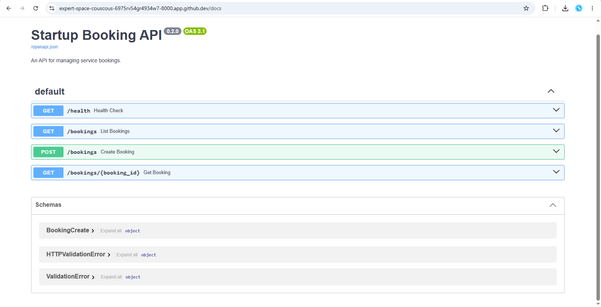
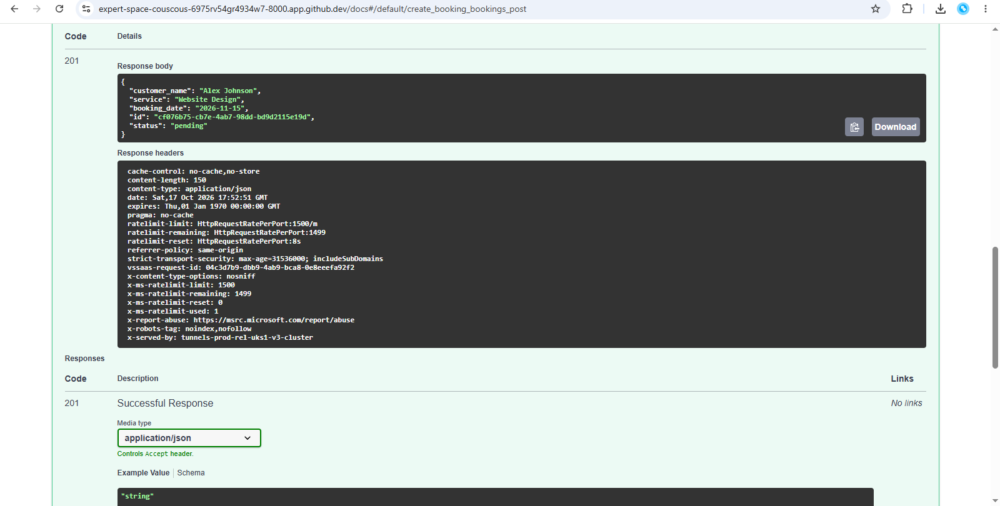
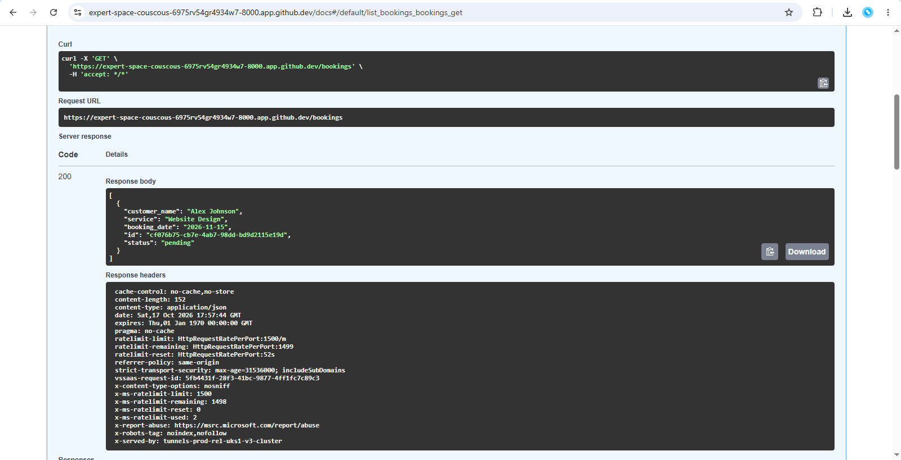
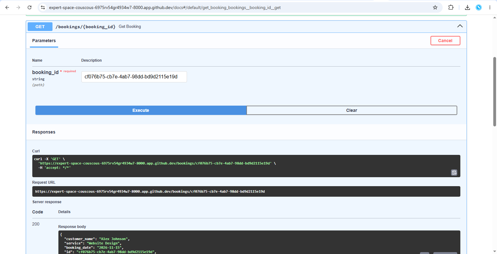
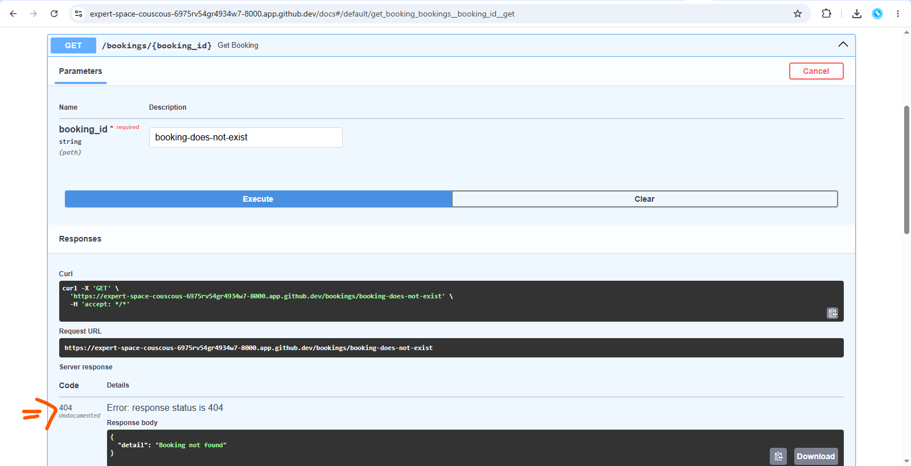
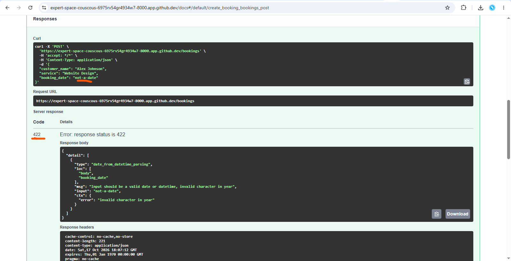

# Startup Booking API

A Python REST API built with FastAPI as a cloud architecture portfolio project. The project demonstrates API development, input validation, HTTP status codes, error handling, and a planned deployment to Amazon Web Services (AWS).

## Project Goals

- Build and test a REST API using Python and FastAPI.
- Implement booking creation and retrieval endpoints.
- Validate request data and handle errors consistently.
- Design a cloud deployment with persistent storage, security, monitoring, and cost awareness.
- Document implementation decisions and test evidence.

## Current Features

- Health check endpoint.
- Create a booking.
- List all bookings.
- Retrieve a booking by ID.
- Validate required fields and booking dates.
- Generate a unique ID for each booking.
- Return appropriate HTTP status codes, including 201, 200, 404, and 422.

## Technology Stack

- Python
- FastAPI
- Pydantic
- Uvicorn
- GitHub Codespaces
- Amazon Web Services (planned deployment)

## API Endpoints

| Method | Endpoint | Description |
|---|---|---|
| GET | `/health` | Check application health |
| POST | `/bookings` | Create a booking |
| GET | `/bookings` | List bookings |
| GET | `/bookings/{booking_id}` | Retrieve a booking by ID |

Interactive API documentation is available at `/docs` while the application is running.

### API Documentation Screenshot

The following screenshot shows the registered endpoints in FastAPI's interactive Swagger UI.



## Local Development

Install the dependencies:

```bash
python -m pip install fastapi "uvicorn[standard]"
```

Start the development server from the repository root:

```bash
python -m uvicorn app.main:app --reload
```

Open `/docs` on the server's local or forwarded URL to test the endpoints.

## Validation and Testing

Manual tests have covered the following scenarios.

### 1. Successful Booking Creation

A valid booking request returns `201 Created` and includes a generated booking ID and pending status.



### 2. List All Bookings

The API returns `200 OK` and a JSON array containing the saved bookings.



### 3. Retrieve a Single Booking

The API retrieves an existing booking using its unique ID.



### 4. Handle a Missing Booking

A request for a nonexistent booking returns `404 Not Found`.



### 5. Validate an Invalid Booking Date

An invalid date is rejected with `422 Unprocessable Entity`.



### 6. Validate Required Fields

A request without the required `customer_name` field is rejected with `422 Unprocessable Entity`.


These screenshots provide evidence of manual API testing. Automated test coverage has not yet been implemented.

## Current Limitations

Bookings are stored in an in-memory dictionary. Data is lost when the application process restarts, and this storage method is not appropriate for a horizontally scaled production service.

Automated tests, persistent storage, cloud deployment, production security, and monitoring are planned improvements.

## Planned AWS Architecture

The next phase will evaluate an architecture using Amazon API Gateway, AWS Lambda with Python, and Amazon DynamoDB. IAM permissions, CloudWatch logging and monitoring, and AWS Budgets will be considered as part of the design.

The final architecture will be documented after implementation and validation.

## Evidence

All screenshot evidence is stored in [`docs/screenshots/`](docs/screenshots/).

